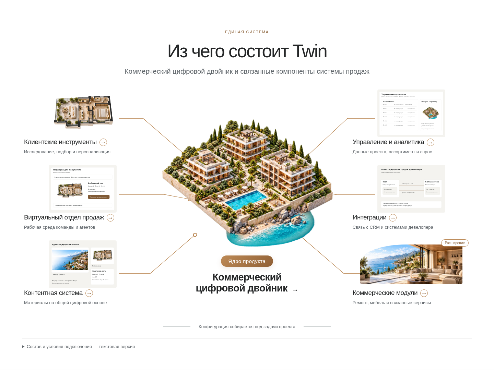
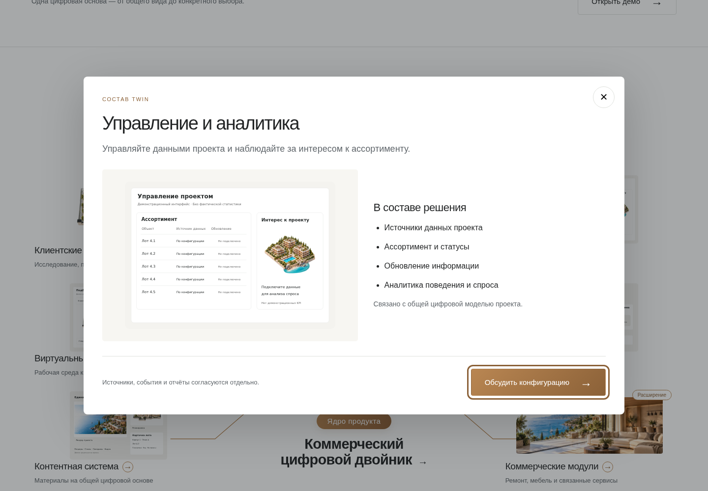
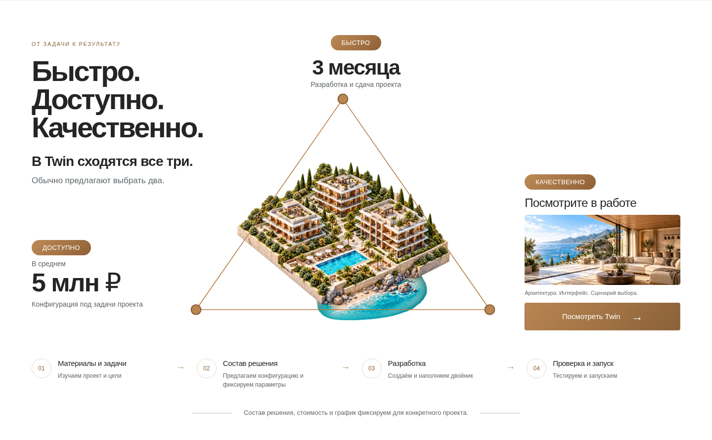
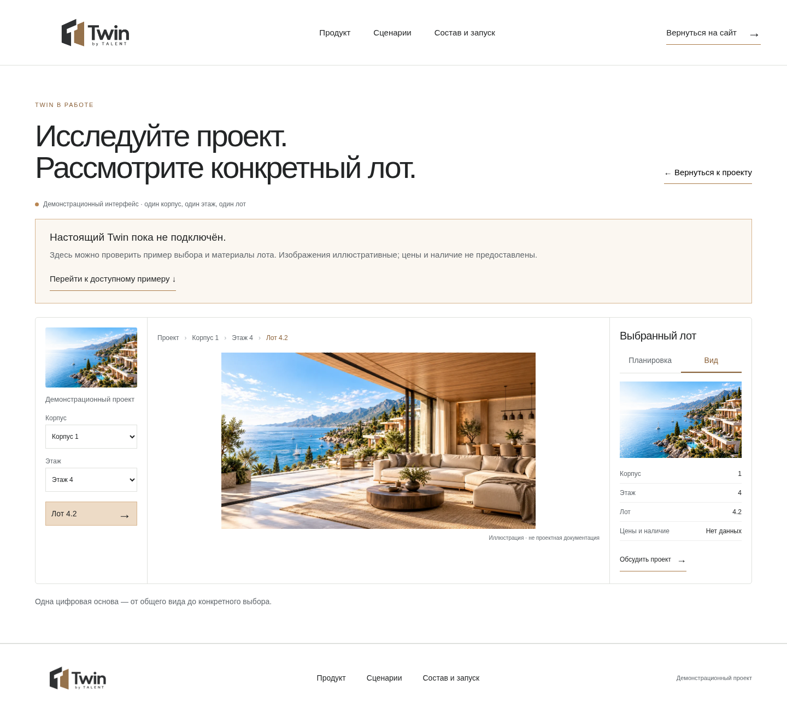

# Twin — результат desktop-разработки

Ниже — изображения работающей версии сайта. Они открываются прямо в GitHub. Это снимки: кнопки на изображениях не нажимаются.

## Первый экран

## Карта состава продукта

## Открытое описание компонента

## Условия реализации

## Демонстрационный выбор лота

## Вся страница

Нажмите на изображение, чтобы рассмотреть его крупнее.

## Что это за версия

Реализована первая версия для компьютера по материалам v1.2 с приоритетными обновлениями v1.3. Проверки сборки, типов и восемь браузерных сценариев прошли. Код находится в этой же ветке; команды запуска — в README.md.

Настоящий 3D-просмотр, отправка заявок и CRM пока не подключены. Иллюстрации и пример выбора обозначены как демонстрационные. Часть изображений карты временная: отдельных изометрических иллюстраций нет в исходном комплекте. Мобильная версия, админка и ИИ — отдельные последующие этапы. Сайт в интернет не опубликован.
